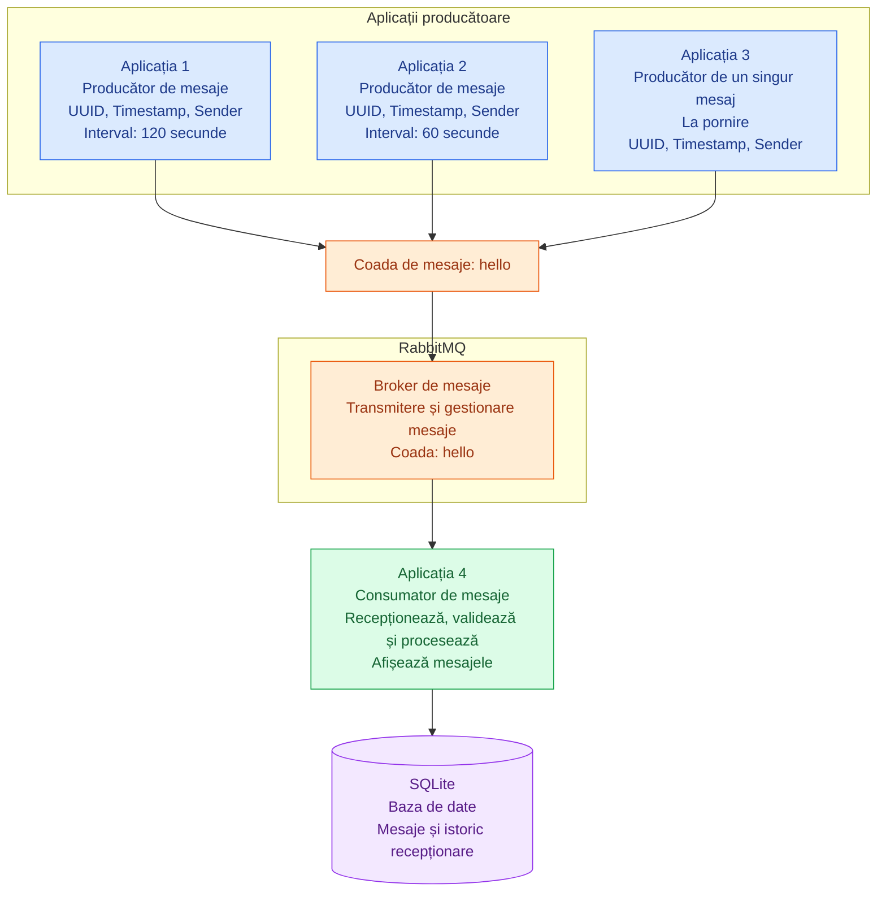

# Sistem de comunicare între aplicații cu RabbitMQ și SQLite

## 🇷🇴 Română

### 1. Descrierea proiectului

Proiectul implementează un sistem de comunicare asincronă între patru aplicații Python, folosind RabbitMQ pentru transmiterea mesajelor și SQLite pentru stocarea permanentă a mesajelor recepționate.

Sistemul este format din trei producători (producers), care transmit mesaje către o coadă RabbitMQ, și un consumator (consumer), care primește mesajele și le salvează într-o bază de date SQLite.

Scopul proiectului este demonstrarea comunicării asincrone între aplicații, a utilizării unei cozi de mesaje și a persistenței datelor într-o bază de date relațională.

## 2. Arhitectura sistemului

Aplicația este organizată în patru proiecte Python independente:

- **pythonProject** – Producătorul 1. Citește mesajele din `Aplicatia_1.txt` și le transmite la fiecare 120 de secunde.
- **pythonProject2** – Producătorul 2. Citește mesajele din `Aplicatia_2.txt` și le transmite la fiecare 60 de secunde.
- **pythonProject3** – Producătorul 3. Citește mesajele din `Aplicatia_3.txt` și transmite un mesaj la pornirea aplicației.
- **pythonProject1** – Consumatorul. Primește mesajele din RabbitMQ și le salvează în baza de date SQLite.

Toate aplicațiile comunică prin coada RabbitMQ numită `hello`.

### Diagrama arhitecturii


## 3. Fluxul mesajelor

1. Producătorii creează mesaje și le serializează în format JSON.
2. Fiecare mesaj primește un identificator unic UUID și un timestamp.
3. Producătorii publică mesajele în coada RabbitMQ `hello`.
4. RabbitMQ păstrează mesajele în coadă până când acestea sunt preluate de consumator.
5. Consumatorul primește mesajul și extrage informațiile din acesta.
6. Mesajul este salvat în baza de date SQLite.
7. După salvarea cu succes în baza de date, consumatorul confirmă recepționarea mesajului către RabbitMQ (ACK).

Dacă salvarea în baza de date eșuează, consumatorul poate solicita retransmiterea mesajului prin mecanismul NACK și requeue.

## 4. Structura mesajelor

Toți cei trei producători utilizează aceeași structură JSON:

```json
    {
        "id_mesaj": "UUID",
        "timestamp_trimis": "data și ora UTC",
        "continut": "conținutul citit din fișier",
        "expeditor": 1
    }
```

Câmpurile mesajului:

| Câmp | Descriere |
|---|---|
| `id_mesaj` | Identificator unic al mesajului, generat cu UUID |
| `timestamp_trimis` | Data și ora la care mesajul a fost trimis |
| `expeditor` | Identificatorul producătorului: 1, 2 sau 3 |
| `continut` | Conținutul mesajului transmis |

### Exemple de mesaje

**Producătorul 1:**

```json
{
  "id_mesaj": "uuid-producator-1",
  "timestamp_trimis": "2026-11-23T10:30:00",
  "expeditor": 1,
  "continut": "message: titlul message_verbose: continutul sender: 1"
}
```

**Producătorul 2:**

```json
{
  "id_mesaj": "uuid-producator-2",
  "timestamp_trimis": "2026-11-23T10:31:00",
  "expeditor": 2,
  "continut": "message: titlul message_verbose: continutul sender: 2"
}
```

**Producătorul 3:**

```json
{
  "id_mesaj": "uuid-producator-3",
  "timestamp_trimis": "2026-11-23T10:32:00",
  "expeditor": 3,
  "continut": "message: titlul message_verbose: continutul sender: 3"
}
```

Valorile UUID și timestamp din exemple sunt ilustrative. La fiecare transmitere se generează un identificator nou și se stabilește momentul real al trimiterii.

## 5. Baza de date SQLite

Consumatorul utilizează SQLite pentru stocarea mesajelor primite.

Baza de date este creată automat în fișierul `mesaje.db`, în directorul aplicației consumatorului.

### Schema bazei de date

Tabelul utilizat se numește `mesaje`.

| Coloană | Tip de date | Descriere |
|---|---|---|
| `id` | INTEGER | Cheie primară, autoincrement |
| `id_mesaj` | TEXT | Identificatorul unic al mesajului |
| `expeditor` | INTEGER | Numărul producătorului |
| `continut` | TEXT | Conținutul mesajului |
| `timestamp_trimis` | TEXT | Momentul trimiterii |
| `timestamp_primit` | TEXT | Momentul recepționării |

Coloana `id_mesaj` are o constrângere de unicitate, pentru a evita salvarea repetată a aceluiași mesaj.

### Interogare SQL pentru vizualizarea mesajelor

```sql
SELECT * FROM mesaje;
```

Pentru afișarea mesajelor în ordinea recepționării:

```sql
SELECT *
FROM mesaje
ORDER BY id ASC;
```

## 6. Tehnologii utilizate

- **Python** – limbajul de programare utilizat pentru dezvoltarea aplicațiilor.
- **RabbitMQ** – broker de mesaje utilizat pentru comunicarea asincronă între producători și consumator.
- **Pika** – bibliotecă Python pentru conectarea și comunicarea cu RabbitMQ.
- **SQLite** – bază de date relațională utilizată pentru stocarea mesajelor.
- **JSON** – formatul utilizat pentru serializarea mesajelor.
- **UUID** – mecanism pentru generarea identificatorilor unici ai mesajelor.
- **Docker** – poate fi utilizat pentru pornirea RabbitMQ într-un container.

## 7. Instalare și configurare

### Cerințe preliminare

- Python 3 instalat.
- RabbitMQ instalat local sau disponibil într-un container Docker.
- pip pentru instalarea bibliotecilor Python.

### Instalarea dependențelor

Din directorul principal al proiectului, execută:

```bash
pip install -r requirements.txt
```

Fișierul `requirements.txt` conține dependența:

```text
pika==1.3.2
```

### Pornirea RabbitMQ cu Docker

Dacă utilizezi Docker, poți porni RabbitMQ cu interfața de administrare folosind:

```bash
docker run -d --name rabbitmq \
  -p 5672:5672 \
  -p 15672:15672 \
  rabbitmq:3-management
```

Interfața de administrare este disponibilă, în mod obișnuit, la:

`http://localhost:15672`

Pentru imaginea standard RabbitMQ Management, datele inițiale de autentificare sunt `guest` / `guest`, pentru conexiuni locale.

### Configurarea conexiunii

Aplicațiile utilizează variabila de mediu `RABBITMQ_HOST`.

Implicit, aceasta are valoarea:

```text
localhost
```

Dacă RabbitMQ rulează pe alt server, setează variabila de mediu la numele sau adresa serverului respectiv.

Exemplu Linux/macOS:

```bash
export RABBITMQ_HOST=localhost
```

Exemplu Windows PowerShell:

```powershell
$env:RABBITMQ_HOST="localhost"
```

## 8. Rularea aplicațiilor

RabbitMQ trebuie pornit înainte de lansarea aplicațiilor Python.

Deschide câte un terminal pentru fiecare aplicație și rulează:

**Consumatorul – pythonProject1**

```bash
python main.py
```

Consumatorul trebuie pornit înaintea producătorilor, pentru a putea observa imediat mesajele transmise.

**Producătorul 1 – pythonProject**

```bash
python main.py
```

Acesta citește conținutul din `Aplicatia_1.txt` și transmite mesaje la intervale de 120 de secunde.

**Producătorul 2 – pythonProject2**

```bash
python main.py
```

Acesta citește conținutul din `Aplicatia_2.txt` și transmite mesaje la intervale de 60 de secunde.

**Producătorul 3 – pythonProject3**

```bash
python main.py
```

Acesta transmite un singur mesaj la pornire.

Fiecare aplicație trebuie lansată din directorul propriu, astfel încât fișierele locale să fie găsite corect.

## 9. Structura proiectului

```text
Sistem-de-comunicare-intre-aplicatii-cu-RabbitMQ-si-SQLite/
│
├── pythonProject/
│   ├── main.py
│   └── Aplicatia_1.txt
│
├── pythonProject1/
│   └── main.py
│
├── pythonProject2/
│   ├── main.py
│   └── Aplicatia_2.txt
│
├── pythonProject3/
│   ├── main.py
│   └── Aplicatia_3.txt
│
├── requirements.txt
└── README.md
```

---

# Application Messaging System Using RabbitMQ and SQLite


## 🇬🇧 English

### 1. Project Description

This project implements an asynchronous messaging system between four Python applications, using RabbitMQ for message delivery and SQLite for persistent message storage.

The system consists of three producers that publish messages to a RabbitMQ queue and one consumer that receives the messages and stores them in an SQLite database.

The purpose of this project is to demonstrate asynchronous communication, message queuing, and database persistence.

## 2. System Architecture

The application consists of four independent Python projects:

- **pythonProject** – Producer 1. Reads messages from `Aplicatia_1.txt` and publishes them every 120 seconds.
- **pythonProject2** – Producer 2. Reads messages from `Aplicatia_2.txt` and publishes them every 60 seconds.
- **pythonProject3** – Producer 3. Reads messages from `Aplicatia_2.txt` and publishes one message when the application starts.
- **pythonProject1** – Consumer. Receives messages from RabbitMQ and stores them in SQLite.

All applications communicate through the RabbitMQ queue named `hello`.

### Architecture Diagram


## 3. Message Flow

1. Producers create messages and serialize them as JSON.
2. Each message receives a unique UUID and a timestamp.
3. Producers publish messages to the RabbitMQ `hello` queue.
4. RabbitMQ holds messages until they are consumed.
5. The consumer receives and processes each message.
6. The message is stored in the SQLite database.
7. After a successful database commit, the consumer acknowledges the message to RabbitMQ using ACK.

If database storage fails, the consumer can reject the message using NACK and request requeueing.

## 4. Message Structure

All three producers use the same JSON structure:

```json
    {
        "id_mesaj": "UUID",
        "timestamp_trimis": "data și ora UTC",
        "continut": "conținutul citit din fișier",
        "expeditor": 1
    }
```

| Field | Description |
|---|---|
| `id_mesaj` | Unique message identifier generated with UUID |
| `timestamp_trimis` | Message creation and sending timestamp |
| `expeditor` | Producer identifier: 1, 2, or 3 |
| `continut` | Message content |

## 5. SQLite Database

The consumer stores received messages in an SQLite database named `mesaje.db`.

The database contains a table named `mesaje` with the following columns:

| Column | Data type | Description |
|---|---|---|
| `id` | INTEGER | Primary key, auto-increment |
| `id_mesaj` | TEXT | Unique message identifier |
| `expeditor` | INTEGER | Producer identifier |
| `continut` | TEXT | Message content |
| `timestamp_trimis` | TEXT | Message sending timestamp |
| `timestamp_primit` | TEXT | Message reception timestamp |

The `id_mesaj` column has a unique constraint to prevent duplicate message records.

To retrieve stored messages:

```sql
SELECT * FROM mesaje;
```

## 6. Technologies Used

- **Python** – application development.
- **RabbitMQ** – message broker for asynchronous communication.
- **Pika** – Python client library for RabbitMQ.
- **SQLite** – relational database for persistent message storage.
- **JSON** – message serialization format.
- **UUID** – unique message identification.
- **Docker** – optional container-based RabbitMQ deployment.

## 7. Installation and Configuration

### Requirements

- Python 3.
- RabbitMQ installed locally or running in Docker.
- pip.

### Install dependencies

```bash
pip install -r requirements.txt
```

The `requirements.txt` file contains:

```text
pika==1.3.2
```

### Run RabbitMQ using Docker

```bash
docker run -d --name rabbitmq \
  -p 5672:5672 \
  -p 15672:15672 \
  rabbitmq:3-management
```

The RabbitMQ management interface is usually available at:

`http://localhost:15672`

### Connection configuration

The applications use the `RABBITMQ_HOST` environment variable. Its default value is `localhost`.

## 8. Running the Applications

Start RabbitMQ first.

Open a separate terminal for each application and run:

Consumer:

```bash
cd pythonProject1
python main.py
```

Producer 1:

```bash
cd pythonProject
python main.py
```

Producer 2:

```bash
cd pythonProject2
python main.py
```

Producer 3:

```bash
cd pythonProject3
python main.py
```

The consumer should be started before the producers.

## 9. Project Structure

```text
Sistem-de-comunicare-intre-aplicatii-cu-RabbitMQ-si-SQLite/
│
├── pythonProject/
│   ├── main.py
│   └── Aplicatia_1.txt
│
├── pythonProject1/
│   └── main.py
│
├── pythonProject2/
│   ├── main.py
│   └── Aplicatia_2.txt
│
├── pythonProject3/
│   ├── main.py
│   └── Aplicatia_3.txt
│
├── requirements.txt
└── README.md
```

---

## 👤 Autor / Author

**IonutD**
